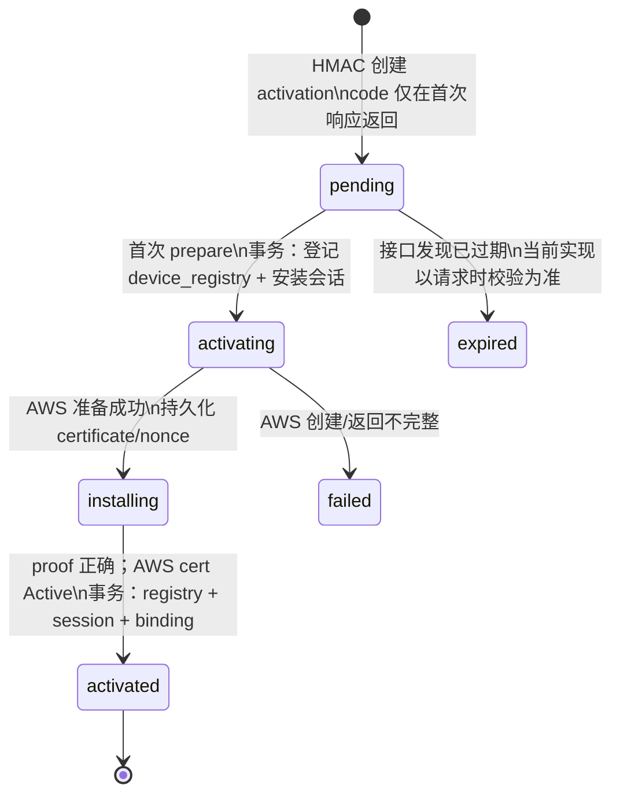
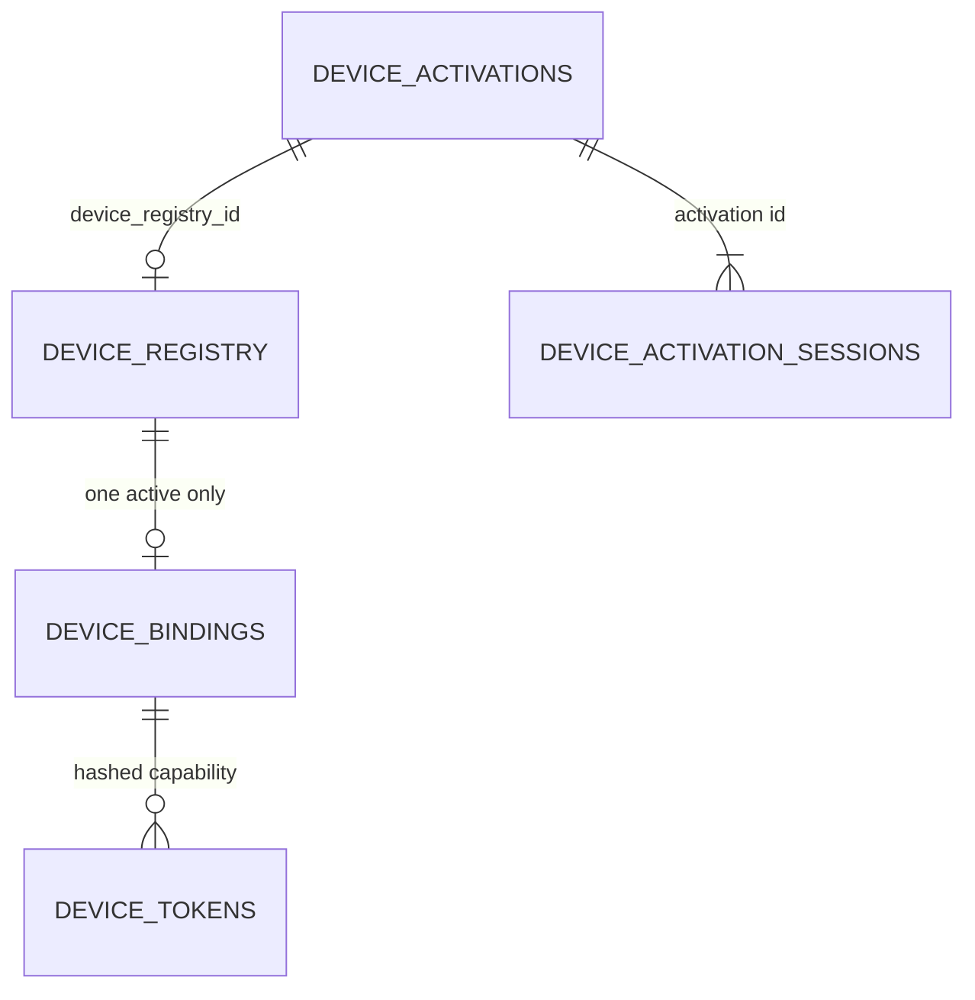
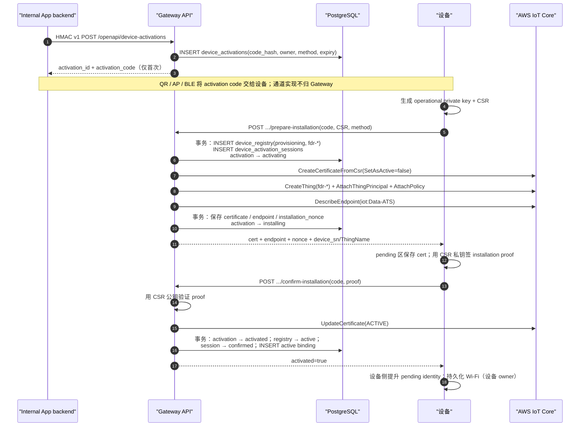

# 设备登记与激活流程：用户 activation → 运行身份安装 → 全局 binding

> **代码反向工程文档。** 本文描述 Gateway 当前 activation-code commissioning 实现。
>
> 最后按代码核对：2026-08-17。

## 先澄清“登记”

这里没有产线领号、chip UID、IDevID 或预先登记的设备身份。Gateway 在设备**首次**调用
`prepare-installation` 时才生成随机 `fdr-<32 hex>`，并在一个 PostgreSQL 事务中创建
`device_registry`：

```text
device_sn = ThingName = MQTT client/runtime ID
pid       = feeder-x1
status    = provisioning
```

因此 `device_sn` 不是芯片 UID，也不能由 App、设备或调用方指定。它是 Gateway 创建的运行身份锚点。

## 参与方与职责

| 参与方 | 职责 | 不是其职责 |
| --- | --- | --- |
| Internal App backend | 从已登录用户派生 `binding_external_user_id`，用 HMAC v1 创建/查询 activation | 不生成设备运行私钥，不直接操作 AWS IoT |
| App / 设备配网通道 | 把 activation code、Wi-Fi 与 CSR 交给设备 | 不保管 Gateway HMAC secret 或设备私钥 |
| 设备 | 本地生成 operational key/CSR，保存 pending 身份并用该私钥证明安装完成 | 不自造 `device_sn` 或 ThingName |
| Gateway | 验证一次性 code、登记设备、准备/确认 AWS 运行身份、收敛 binding | 不保存 operational private key |
| AWS IoT Core | 创建 certificate、Thing、principal/policy，最终激活 certificate | 不判断用户归属 |
| PostgreSQL | activation、设备、安装会话与 binding 的权威状态 | 不代替 AWS certificate 生命周期 |

## 创建 activation

Internal App backend 对 `POST /api/v1/openapi/device-activations` 发送 HMAC v1 请求：

```json
{
  "method": "qr",
  "pid": "feeder-x1",
  "binding_external_user_id": "backend-derived-user-id",
  "idempotency_key": "caller-generated-key"
}
```

- `method` 只允许 `qr`、`ap`、`ble`；Gateway 不把它们互相 fallback。
- PID 可省略；提供时只能是 `feeder-x1`。
- activation code 是 32 random bytes 的 base64url。响应首次包含 `activation_code`；QR 还以兼容字段
  `qr_authorization_code` 返回同一个值。PostgreSQL 只保存 SHA-256 hash。
- 激活有效期为 5 分钟。`(internal_app_id, idempotency_key)` 唯一；同 key、不同请求事实返回
  `409 idempotency_conflict`，同一进行中请求返回 `409 activation_in_progress`。
- AP/BLE 的 `POST .../{activation_id}/sessions` 当前只校验同一 Internal App、外部用户和非空 session
  形状后返回 activation；当前 Gateway 不在此端点持久化协商 Grant。实际安装会话由首次 prepare 建立。

`GET /api/v1/openapi/device-activations/{id}` 只允许创建它的 Internal App 查询，且不会再次返回 code。
API 响应对外只投影 `pending`、`installing`、`activated`；数据库内部仍保留更细的状态。

## 状态与持久化不变量





`uniq_device_bindings_active_device` 保证同一 `device_registry_id` 同时最多一条 active binding；
`binding_external_user_id` 还受数据库 trigger 保护，不能被 UPDATE 静默替换。

## 完整成功时序



## 两阶段安装的准确语义

### Prepare：先预留数据库身份，再准备 AWS 资源

设备按通道调用下列之一：

- `POST /api/v1/device-activations/session/prepare-installation`：请求中显式 `method=ap|ble`。
- `POST /api/v1/device-activations/qr/prepare-installation`：只接受 QR activation。

两者都必须携带 `activation_id`、`activation_code` 和 PEM CSR。`activation.Service.Prepare` 先校验：

1. activation 存在、未到期、code hash 相等且 method 精确匹配；
2. 首次 prepare 生成内部 UUID 和随机 `device_sn`；
3. `ActivationRepository.ReservePreparation` 的事务创建 `device_registry`、`device_activation_sessions`，把 activation
   标记为 `activating`；
4. `awsiot.Provisioner.Provision` 按顺序创建 **inactive** CSR certificate、Thing、exclusive Thing principal、policy，
   再读取 ATS endpoint；
5. Gateway 写入 certificate、endpoint、nonce 后才返回安装材料。

重试同一 activation + 相同 CSR 时会返回已有 installation；不同 CSR 返回冲突，避免把同一授权 code
换绑到另一把私钥。

### Confirm：证明私钥已在设备侧可用，再收敛数据库归属

设备用 CSR 公钥对应的私钥，对下列精确消息的 SHA-256 签名：

```text
ExploreX-Activation-Code-Commissioning-v1/install:<activation_id>:<installation_nonce>
```

Gateway 验证 PEM CSR 自签名和 installation proof；仅成功后才调用 AWS `UpdateCertificate(ACTIVE)`，随后在
`CompleteActivation` 的单一 PostgreSQL 事务中更新 activation、registry、session 并插入 binding。

AWS 调用和数据库事务不能形成跨服务事务。因此证书激活发生在 PostgreSQL 最终提交之前；数据库唯一约束
或提交失败会返回错误，不能被文档描述成“全局 ACID saga”。这也是 staging/真机恢复路径仍需验证的原因。

`expired` 是 schema/status 枚举中的有效值；当前 `activation.Service` 在 Get/Prepare/Confirm 时按
`expires_at` 拒绝过期的非 activated activation，尚未在这条请求路径中把记录 UPDATE 为 `expired`。

## 失败与安全边界

| 条件 | Gateway 行为 |
| --- | --- |
| HMAC、nonce 或 Internal App 不合法 | `/openapi/*` 在路由前拒绝；Redis replay protection 不可用也 fail closed |
| code、method、过期时间不匹配 | `403 activation_forbidden` 或 `410 activation_expired` |
| AWS prepare 失败或返回不完整 | `FailPreparation`：activation/session 标失败，registry 标 `revoked` |
| CSR 改变或并发 prepare | `409 activation_in_progress`；不同 CSR 的已准备 activation 走兼容 `activation_failed` 错误 |
| proof 不属于 CSR 私钥 | `403 activation_forbidden`，certificate 不会因该请求激活 |
| active binding 冲突 | PostgreSQL 唯一索引拒绝，HTTP 为 `409 device_binding_conflict` |

activation code、HMAC secret、operational private key 和 token 都不能记录进日志或文档示例。当前 activation
code 只是短时一次性安装能力，不是设备出生身份；它不能单独证明设备来自可信供应链。

## 关键实现与验证

| 目标 | 事实源 |
| --- | --- |
| 路由、请求/响应、错误映射 | `internal/httpapi/server.go`：`createActivation`、`prepareDevice`、`confirmDevice` |
| 状态机、code/CSR/proof 校验 | `internal/activation/service.go`、`internal/activation/types.go` |
| AWS IoT 资源顺序 | `internal/awsiot/provisioner.go`：`Provision`、`Activate` |
| 原子登记/激活/binding | `internal/platform/postgres/activation_repository.go`：`ReservePreparation`、`CompletePreparation`、`CompleteActivation` |
| 表约束 | `db/migrations/001_initial.sql`、`db/migrations/schema_contract_test.go` |
| 回归测试 | `go test -race -count=1 ./internal/activation ./internal/httpapi ./internal/platform/postgres` |

本文只记录源码与测试可证明的流程；当前 staging 真机 QR/AP/BLE E2E 仍以聚合工作区的 active follow-up
清单为准。
