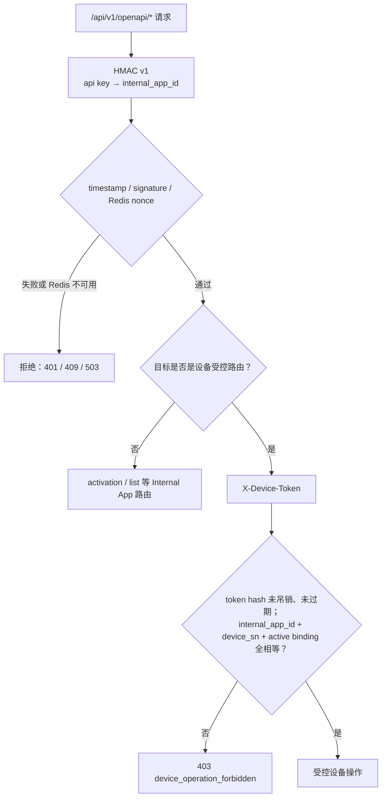
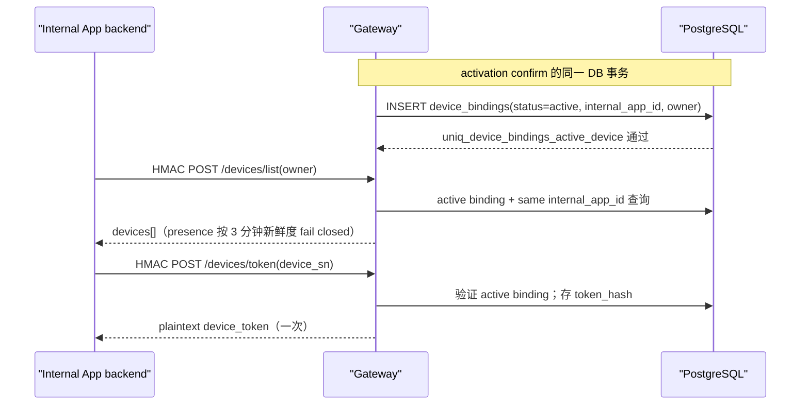

# 设备绑定、Device Token 与受控操作流程

> **代码反向工程文档。** 本文定义 Internal App HMAC 身份、全局 binding、Device Token 和设备 API 的
> 准入顺序。
>
> 最后按代码核对：2026-08-17。

## 目标与非目标

Gateway 允许多个内部 App 使用同一服务，但它们不是 tenant。凭证权威源是平台面的 `api_credentials`（归属
project），`INTERNAL_APPS_JSON` 保留为本地开发与应急的第二来源；无论来源，主体 id 都只用于归属与作用域，
不构成 tenant 隔离。门户登录与 Project/Product 管理属于平台面，见
[Platform Plane v1](../architecture/platform-plane-v1.md)，本流程不展开。

设备只能有一条**全局** active binding；更换到另一个 Internal App 前必须显式释放现有 binding。一个
`binding_external_user_id` 只是可信 Internal App backend 从自己的登录会话派生的用户标识，Gateway 不拥有
用户登录态，不能接受手机客户端任意给出的 owner 字段作为“同一人”的证据。

## 两层授权



### HMAC v1

`HMACMiddleware` 覆盖所有 `/api/v1/openapi/*`：

- `X-Api-Key`、20 位 `X-Timestamp`、`X-Nonce`、`X-Signature`；
- 签名域是 `ExploreX-OpenAPI-HMAC-v1`，覆盖 method、canonical path/query 和精确 body hash；
- 时钟窗口为 ±5 分钟；Redis 以 `(internal_app_id, nonce)` 原子消费 nonce，TTL 10 分钟；
- Redis 不可用返回 `503 replay_protection_unavailable`，不会降级为无重放保护的验签；
- HMAC request body 最大 1 MiB，业务 JSON decoder 再将普通 JSON body 限制为 32 KiB 且拒绝未知字段。

### Device Token

activation 成功后，Internal App backend 以 HMAC 调用 `POST /api/v1/openapi/devices/token`，提交
`device_sn`。Gateway 只在该 `internal_app_id` 对该设备已有 active binding 时签发 32 random bytes 的
base64url token：

- 明文仅在签发响应出现；PostgreSQL 只存 SHA-256 hash；
- 默认有效期 24 小时；
- 每次设备受控操作同时校验 token 未过期、未撤销、binding active、同一 Internal App 及同一 `device_sn`；
- 释放 binding 会撤销该 binding 下所有 token。

## binding 收敛与可见性



`device_bindings` 有两个不同层面的保护：

1. 部分唯一索引 `uniq_device_bindings_active_device` 阻止一台 `device_registry` 同时绑定多个 App 或用户；
2. `trg_enforce_device_binding_user_invariant` 禁止把已存在 binding 的
   `binding_external_user_id` 更新为另一个值。设备移交必须走释放后重新激活，而不是覆盖 owner。

`POST /api/v1/openapi/devices/list` 只由 HMAC 保护，并按 caller 提供的 `binding_external_user_id` 过滤。
所以调用它的 backend 必须从自己的认证 session 派生该字段；Gateway 不提供用户 JWT/session 验证。

## 受控路由分类

下列设备路由都先经过 HMAC 与 `X-Device-Token`：

| 路径 | 后续动作 | 绑定约束 |
| --- | --- | --- |
| `GET .../{device_sn}`、`GET .../shadow` | 返回受 binding 限定的详情或 AWS IoT Shadow | 同 App、同 SN、active token |
| `POST .../commands`、`PUT .../schedules` | 发送 MQTT command，按需等 ACK | 同上 |
| `GET .../events` | 从 `device_events` 查询 | 同上 |
| `POST/DELETE .../streams` | KVS viewer grant + device WebRTC ACK | 同上，stream 绑定 `device_binding_id` |
| `POST/DELETE .../local-media-sessions` | capability 门禁 + typed MQTT ONVIF/RTSP 短租约 | 同上，临时凭据不落库 |
| `POST/GET .../snapshots`、`.../recordings` | S3 presigned URL + 设备指令/状态 | 同上，asset 绑定 `device_binding_id` |
| `POST/DELETE .../feed-audio` | S3 上传 + MQTT 音频指令 | 同上 |
| `POST .../network-reconfiguration-authorizations` | 仅批准原绑定用户的换网请求 | 另有 owner/digest 校验，见重置流程 |

任何失败都使用兼容扁平错误形状：

```json
{"error_code":"device_operation_forbidden","message":"device operation is forbidden","error":"device operation is forbidden"}
```

不返回 SQL、Redis、AWS 或 token hash 细节。

## WebRTC 的额外设备事实门禁

`POST .../streams` 不是“Gateway 签 URL 就成功”：

1. Gateway 为 `kvs_channel_prefix + device_sn` 确保 KVS channel，并获得短期 signaling/ICE 信息；
2. 同一请求通过 MQTT `stream` command 要求设备启动 viewer；
3. 设备 ACK 必须回显 `viewer_client_id`、`webrtc.v1`、firmware version、supported 与 accepted capabilities；
4. accepted 必须是 requested/supported 的子集。LivPet 旧 viewer 使用 `CreateExact`，若未获完整能力，Gateway
   会发 stop command 并返回 `409 stream_capability_unavailable`。

这样 binding 授权不伪造设备实际 WebRTC 能力。

## 关键实现与验证

| 目标 | 事实源 |
| --- | --- |
| HMAC canonical 验证和 nonce fail-closed | `internal/httpapi/hmac_middleware.go`、`internal/internalauth/` |
| token 签发、校验、解绑 | `internal/modules/binding/service.go`、`internal/platform/postgres/binding_repository.go` |
| 所有设备路由的统一准入 | `internal/httpapi/server.go`：`serveDeviceOperation` |
| 指令与 ACK | `internal/modules/device/service.go` |
| WebRTC capability negotiation | `internal/modules/media/stream.go` |
| ONVIF/RTSP 短租约与严格 ACK | `internal/modules/media/local_media.go`、`internal/modules/device/service.go` |
| binding/token schema 约束 | `db/migrations/001_initial.sql`、`db/migrations/schema_contract_test.go` |
| 回归测试 | `go test -race -count=1 ./internal/internalauth ./internal/httpapi ./internal/modules/binding ./internal/modules/device ./internal/modules/media` |
