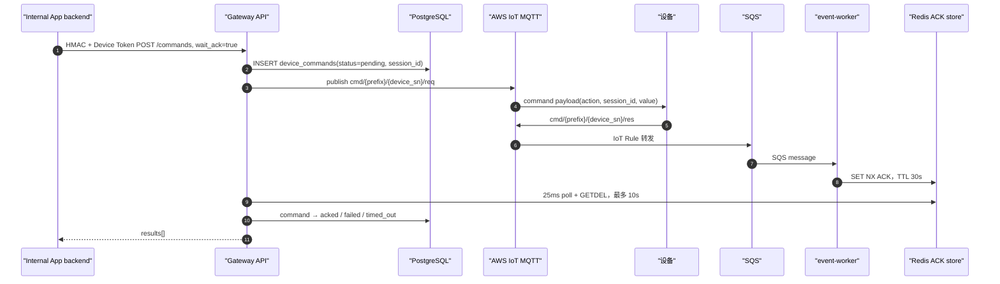
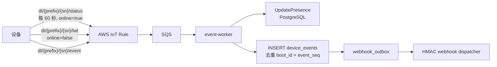
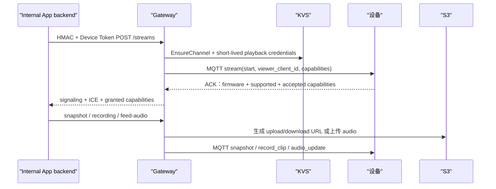
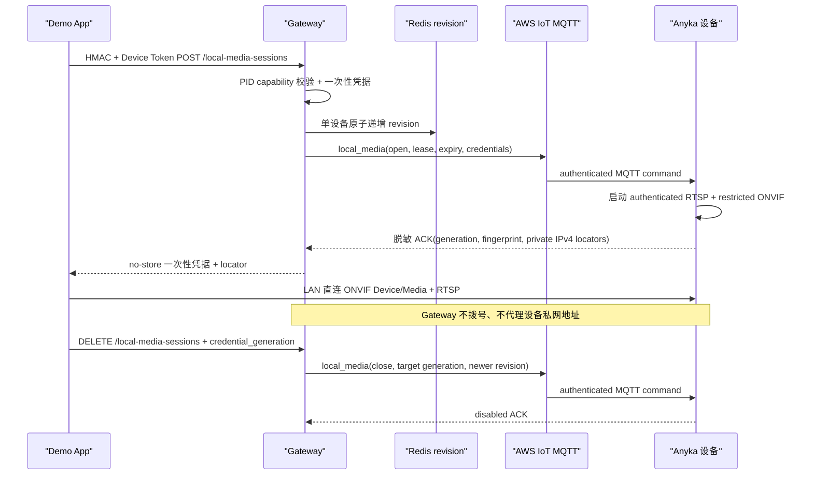

# 设备运行态、事件与媒体流程

> **代码反向工程文档。** 本文描述 activation 后 Gateway 如何把 binding 约束延续到 MQTT、presence、事件、
> Webhook、WebRTC、局域网 ONVIF/RTSP 租约、snapshot、recording 和 feed audio。
>
> 最后按代码核对：2026-08-24。

## 运行期组件边界

| 组件 | 权威职责 | 非权威职责 |
| --- | --- | --- |
| PostgreSQL | command/ACK 状态、presence 投影、事件、媒体元数据、outbox | 不承担短期同步 ACK 等待 |
| Redis | HMAC nonce、10 秒 command 等待中的 ACK 交换 | 不保存设备业务历史 |
| AWS IoT Core | MQTT publish、Shadow、IoT Rule 事件入口 | 不作用户 binding 判断 |
| SQS + `event-worker` | 消费 IoT Rule 消息、写事件/presence、分发 webhook | 不提供 HTTP API |
| KVS / S3 | 短期 WebRTC signaling、媒体对象和 presigned URL | 不绕过 Gateway binding |
| 设备 LAN | 在 MQTT 租约内直连 ONVIF/RTSP | Gateway 不代理、不拨号私网 locator |

设备操作均先过 HMAC v1 + `X-Device-Token`，详见[绑定与 Token 流程](设备绑定、Device%20Token%20与受控操作流程.md)。

## Command 与 ACK



`device.Service.SendCommands` 在发布前插入 `device_commands`，每条 command 都有独立 session ID。`wait_ack=true`
时最多等待 10 秒：

- ACK `code=0` → `acked`，响应 `status=success`；
- `code=-2` / `-6` → `device_busy` / `device_jammed`；
- 没有 ACK 或等待超时 → `timed_out` 并向 API 返回 `409 device_offline`；
- publish 失败 → `failed`；
- `wait_ack=false` 只在发布后记 `published`，响应 `accepted`。

设备 ACK topic 仅接受精确 `cmd/{topic_prefix}/{device_sn}/res`。event-worker 会验证 topic namespace、
device SN 和 session ID；Redis 使用 `SET NX` 保留第一份 ACK，避免重复 SQS 投递改变已等待的结果。

## Presence 与事件



Presence 使用消息中的 `received_at_ms`，而非设备本地时钟。`UpdatePresence` 只接受比当前记录更新的观测时间；
同一时间戳时 offline 会胜过 online，防止乱序把离线设备重新标在线。HTTP device list 还会要求
`last_seen_at` 在 3 分钟内，否则即使数据库残留 online 也 fail closed 为离线。

普通事件必须有 UUID `event_id`、UUID `boot_id`、非负 `event_seq` 和 object `data`。数据库唯一约束
`(device_registry_id, boot_id, event_seq)` 使 SQS 重投不重复写业务事件。`record_clip_done` 事件会更新
对应 recording 的状态；有 active binding 时，事件与 webhook outbox 在同一 PostgreSQL 事务中写入。

Webhook dispatcher 只向部署配置中该 `internal_app_id` 已订阅的 event type 投递。每次投递包含：

- `X-Explorex-Timestamp`；
- `X-Explorex-Delivery`；
- `X-Explorex-Event`；
- `X-Explorex-Signature = sha256(HMAC(webhook_secret, timestamp + "." + payload))`。

非 2xx 或网络失败会指数退避；8 次后 outbox 标 `dead`，投递尝试独立留在 `webhook_deliveries`。

## WebRTC 与媒体对象



- WebRTC stream 只有设备 ACK 的 capability contract 合法时才写 `device_streams` 并返回 viewer grant；旧 LivPet
  兼容调用要求 exact grant，部分能力时会 stop stream 并返回冲突。
- Snapshot 先创建 `device_snapshots(pending)`，生成 15 分钟 S3 upload URL，再发 `snapshot` command；对象存在后才
  视为 `ready` 并返回短期 download URL。
- Recording 时长被限制为 5–60 秒；创建 pending record 和 upload URL 后发 `record_clip`，后续
  `record_clip_done` 事件确定 ready/failed。
- Feed audio 最大 1 MiB，上传到 S3 后携带短期 URL、SHA-256 与 size 发 `audio_update`；不把音频正文放进 MQTT。
- 所有 stream/snapshot/recording 查询都用 `device_binding_id + device_sn` 过滤，不能从其他绑定读取对象。

## 局域网 ONVIF/RTSP 短租约



- 租约长度限制为 30–900 秒；App 在到期前续租时以更高 revision 和新 generation
  替换板端租约，新播放器就绪后再释放旧播放器。用户离开时只 close 当前 generation，
  迟到 close 不能关闭新租约。
- `local_media` 临时密码只穿过当次 HTTP 响应、Gateway 请求内存、MQTT 和设备运行内存；
  不写 PostgreSQL/Redis/command history，不出现在设备 ACK 或日志中。
- 首次成功应用的 ACK 使用 `result=applied`；相同 revision/payload 的 MQTT QoS 1 重投可返回
  `result=duplicate`，Gateway 只在其余 open/close ACK 字段仍精确一致时接受。
- ONVIF 仅用于局域网媒体发现和取流地址。喂食、PTZ 等 DP 仍由 App 调用 Gateway
  OpenAPI，再由 Gateway 经 MQTT 下发，不经 ONVIF PTZ。

## 关键实现与验证

| 目标 | 事实源 |
| --- | --- |
| API 路由与 media 响应 | `internal/httpapi/server.go`：`serveDeviceOperation` |
| command publish/ACK 状态机 | `internal/modules/device/service.go` |
| SQS 轮询和 topic 分流 | `cmd/event-worker/main.go`、`internal/worker/ingest.go`、`internal/modules/events/ingest.go` |
| presence/event/outbox 原子写 | `internal/platform/postgres/event_repository.go` |
| Redis ACK 生命周期 | `internal/platform/redis/ack_store.go` |
| Webhook HMAC 与重试 | `internal/modules/webhooks/dispatcher.go`、`internal/platform/postgres/webhook_repository.go` |
| WebRTC/S3 media | `internal/modules/media/stream.go`、`internal/modules/media/assets.go` |
| 局域网媒体租约 | `internal/modules/media/local_media.go`、`internal/platform/redis/local_media_revision.go` |

建议回归命令：

```sh
go test -race -count=1 ./internal/modules/device ./internal/modules/events ./internal/modules/media ./internal/modules/webhooks ./internal/worker ./internal/platform/postgres
```
