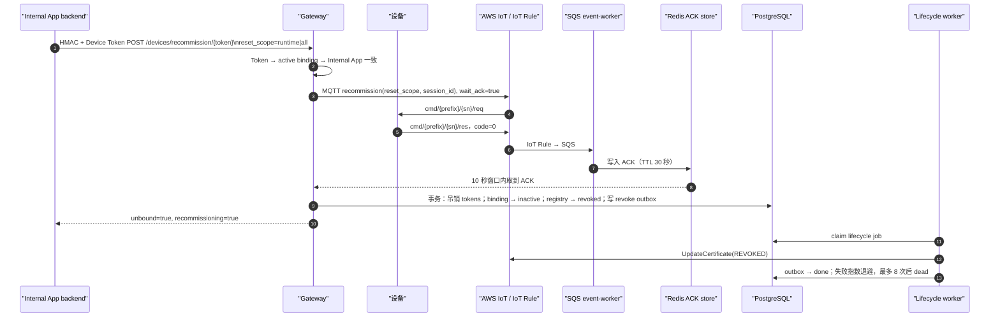
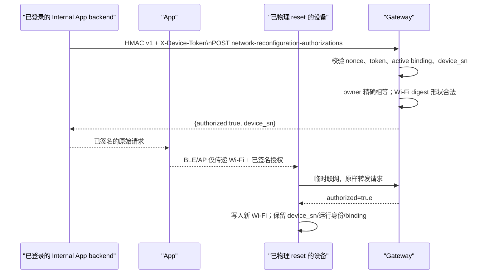

# 设备重置、解绑与重新配网流程

> **代码反向工程文档。** “恢复出厂”“解绑”“recommission”和“原绑定用户换网”是四个不同的状态转换，
> 不能混为一个 reset 按钮。
>
> 最后按代码核对：2026-08-17。

## 决策表

| 场景 | 设备是否必须 ACK | binding 是否释放 | Wi-Fi / 用户数据 | 运行证书 |
| --- | --- | --- | --- | --- |
| `recommission(runtime)` | 是；无 ACK 不释放 | 成功 ACK 后释放 | 设备按 runtime scope 清理 | 释放后由 lifecycle worker 吊销 |
| `recommission(all)` | 是；无 ACK 不释放 | 成功 ACK 后释放 | 设备按 all scope 清理 | 同上 |
| `unbind/{device_token}` | 当前实现不向设备发送命令 | 立即释放 | Gateway 不承诺设备本地清理 | 通过 outbox 异步吊销 |
| 物理按键恢复出厂 | 不适用；Gateway 不参与按键 | **不释放** | 清除设备本地 Wi-Fi 与用户数据 | 保留运行身份 |
| 原绑定用户重新配网 | 设备转发预签名请求 | 不释放 | 仅重写新 Wi-Fi | 保留运行身份 |

对需要“设备移交前确认设备实际执行过清理”的产品流程，应使用 ACK-based `recommission`，不能把
逻辑 `unbind` 当作等价替代。

## ACK-based recommission



实现细节：

- 端点：`POST /api/v1/openapi/devices/recommission/{device_token}`；`reset_scope` 仅允许 `runtime` 或 `all`，
  省略时当前 HTTP handler 默认 `runtime`。
- `DeviceRecommissioner.Reset` 必须只收到一条 `recommission` command；ACK 必须带非空 command/session ID、
  合法 status 和数值 `code`。只有 `status=success && code=0` 才进入释放。
- 设备离线、超时、ACK 非零、ACK 形状不合法或 scope 不合法时返回
  `409 device_recommission_unavailable`，并明确保持 binding active。
- release PostgreSQL 事务撤销该 binding 的全部 token，标 binding `inactive`、registry `revoked`，再写
  `device_lifecycle_outbox(revoke_certificate)`。AWS 吊证是异步补偿，不在 HTTP 成功前同步完成。

为 LivPet wire compatibility，单条 `commands` 中的 `factory_reset` 且 `value.scope=all`、
`wait_ack=true` 会在 Gateway 内部映射到 `recommission(all)`，最终仍只有收到成功 ACK 才释放。
`reset_wifi`、`factory_reset(scope=wifi)`、没有显式 scope 的 `factory_reset`，以及混入批量 commands 的
生命周期 reset 都在 MQTT publish 前以 `400 invalid_request` 拒绝。

## 物理恢复出厂不是解绑

物理按键的设备端行为是：删除本地 Wi-Fi 和用户数据，使设备回到“交付给用户时的本地状态”；它不应删除
Gateway 生成的 `device_sn`、AWS IoT 运行身份或 active binding。Gateway 不接收该按键事件，也不会为它创建
新的 activation。

这保证原绑定用户可以在无需解绑/再绑定的情况下重新写 Wi-Fi；同时避免任何持有设备的人通过普通
activation 抢占它的现有归属。

## 原绑定用户预签名换网



设备不能让 App 重新拼签名，也不能把 Wi-Fi 明文上传 Gateway。其请求 body 只有：

```json
{
  "binding_external_user_id": "backend-derived-user-id",
  "wifi_credentials_sha256": "lowercase-64-hex"
}
```

Gateway 要求 HMAC v1、未重放 nonce、该 binding 的 `X-Device-Token`、token 所属 Internal App 与
`device_sn` 都匹配；然后把 `binding_external_user_id` 与 active binding 精确比较。Backend 必须从自己的
登录会话生成该 ID，不能信任客户端任填值。

`wifi_credentials_sha256` 的 canonical preimage 是下面四个 UTF-8 字段按此顺序逐个 `u32 big-endian
length || bytes` 拼接后取 SHA-256 小写 hex：

```text
ExploreX-Bound-WiFi-Reconfiguration-v1
device_sn
wifi_ssid
wifi_password
```

SSID/password 都拒绝 C0 控制字符和 DEL；密码允许空、8–63-byte passphrase 或精确 64-byte hex PSK。
此接口不创建 activation、不更改 binding，也不存储 Wi-Fi 明文。已冻结测试向量：

```text
device_sn = fdr-00000000000000000000000000000001
ssid      = Lab-WiFi
password  = demo-pass
sha256    = 0c8f371a2f7e8d9b4c717f22fea097fe53750c0c3c9705611ca4c58594e48fcc
```

## 不变量与实现锚点

| 不变量 | 事实源 |
| --- | --- |
| active binding 一台设备最多一条 | `uniq_device_bindings_active_device`，`migrations/sql/001_initial.sql` |
| owner 不能 UPDATE 覆盖 | `trg_enforce_device_binding_user_invariant` |
| token 随 binding 释放撤销 | `internal/platform/postgres/binding_repository.go`：`ReleaseBinding` |
| ACK 成功才 recommission release | `internal/modules/binding/service.go`：`Recommission`；`recommissioner.go` |
| certificate 吊销的异步补偿 | `internal/worker/lifecycle.go`、`internal/platform/postgres/lifecycle_repository.go` |
| HTTP 路由和 factory-reset 兼容映射 | `internal/httpapi/server.go`：`unbindDevice`、`recommissionDevice`、`serveDeviceOperation` |

建议回归命令：

```sh
go test -race -count=1 ./internal/httpapi ./internal/modules/binding ./internal/platform/postgres ./internal/worker
```
